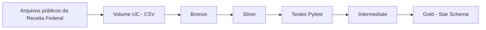

# CNPJ Data Lakehouse v3

Projeto de engenharia de dados para ingestão e modelagem dos dados públicos de cadastro nacional de pessoas jurídicas da Receita Federal no Databricks.

O repositório usa **Databricks Asset Bundles**, **Lakeflow Declarative Pipelines**, **Databricks Workflows**, **PySpark**, **SQL** e **Pytest** para entregar uma arquitetura em camadas com modelo dimensional na camada Gold.

## Visão geral



O fluxo completo é orquestrado pelo job `Pipeline Job`, definido em [resources/pipeline_job.yml](resources/pipeline_job.yml).

## Arquitetura do pipeline

| Etapa | Implementação | Resultado |
|---|---|---|
| Download | [src/download_data.ipynb](src/download_data.ipynb) | Download dos `.zip`, extração e gravação dos CSV em um Volume gerenciado |
| Bronze | [src/transformations/ingest_bronze_data.py](src/transformations/ingest_bronze_data.py) | Leitura incremental dos arquivos brutos com Auto Loader |
| Qualidade | [tests/test_silver_quality.py](tests/test_silver_quality.py) | Testes de unicidade e integridade referencial após a Silver |
| Silver | [src/transformations/ingest_silver_data.py](src/transformations/ingest_silver_data.py) | Limpeza, tipagem, normalização de datas e validações DLT |
| Intermediate | [src/transformations/ingest_intermediate_data.py](src/transformations/ingest_intermediate_data.py) | Tabelas intermediárias, dimensões auxiliares e chaves substitutas |
| Gold | [src/transformations/ingest_gold_data.sql](src/transformations/ingest_gold_data.sql) | Views materializadas, fato, dimensões, bridges e agregações |

### Fluxo de execução

```text
download_data
    -> ingest_bronze_data
    -> ingest_silver_data
    -> run_silver_tests
    -> ingest_intermediate_data
    -> ingest_gold_data
```

Os testes são executados depois da Silver e antes das tabelas Intermediate e Gold.

### Modelo analítico da camada Gold

- **Fato:** `fact_estabelecimentos`
- **Dimensões:** `dim_cnaes`, `dim_localidades`, `dim_naturezas_juridicas`, `dim_situacoes`, `dim_socios`, `dim_tempo_inicio_atividades`, `dim_tempo_situacoes_cadastrais` e `dim_tempo_situacoes_especiais`
- **Tabelas bridge:** `bridge_estabelecimentos_cnaes` e `bridge_estabelecimentos_socios`
- **Agregações:** `agg_fact_estabelecimentos` e `agg_fact_estabelecimentos_cnaes`

## Estrutura do repositório

```text
.
├── databricks.yml                 # Bundle, variáveis e targets
├── resources/
│   └── pipeline_job.yml           # Pipelines declarativos e workflow
├── src/
│   ├── download_data.ipynb        # Download e extração dos dados
│   └── transformations/
│       ├── ingest_bronze_data.py
│       ├── ingest_silver_data.py
│       ├── ingest_intermediate_data.py
│       └── ingest_gold_data.sql
├── tests/
│   └── test_silver_quality.py     # Unicidade e integridade referencial
└── .github/workflows/
    └── ci-cd.yml                  # Validação e deploy dos bundles
```

## Pré-requisitos

- Conta e workspace no Databricks
- Unity Catalog habilitado
- Databricks CLI configurada
- Python `3.12`
- [uv](https://docs.astral.sh/uv/) para gerenciamento do ambiente local
- Extensão Databricks para VS Code, opcional

### Recursos Unity Catalog

O projeto foi testado no Databricks Free Edition. Nesse ambiente, catálogos, schemas e volumes gerenciados precisam ser criados manualmente antes do primeiro deploy. Execute os comandos abaixo no SQL Editor do Databricks com uma identidade que tenha permissão para criar esses recursos.

| Target | Catálogo | Schemas | Volume |
|---|---|---|---|
| `dev` | `dev_cnpj_data_lakehouse_v3` | `bronze`, `silver`, `gold` | `bronze.raw` |
| `staging` | `stg_cnpj_data_lakehouse_v3` | `bronze`, `silver`, `gold` | `bronze.raw` |
| `prod` | `prod_cnpj_data_lakehouse_v3` | `bronze`, `silver`, `gold` | `bronze.raw` |

Crie os recursos Unity Catalog para os três ambientes:

```sql
CREATE CATALOG IF NOT EXISTS dev_cnpj_data_lakehouse_v3;
CREATE SCHEMA IF NOT EXISTS dev_cnpj_data_lakehouse_v3.bronze;
CREATE SCHEMA IF NOT EXISTS dev_cnpj_data_lakehouse_v3.silver;
CREATE SCHEMA IF NOT EXISTS dev_cnpj_data_lakehouse_v3.gold;
CREATE VOLUME IF NOT EXISTS dev_cnpj_data_lakehouse_v3.bronze.raw;

CREATE CATALOG IF NOT EXISTS stg_cnpj_data_lakehouse_v3;
CREATE SCHEMA IF NOT EXISTS stg_cnpj_data_lakehouse_v3.bronze;
CREATE SCHEMA IF NOT EXISTS stg_cnpj_data_lakehouse_v3.silver;
CREATE SCHEMA IF NOT EXISTS stg_cnpj_data_lakehouse_v3.gold;
CREATE VOLUME IF NOT EXISTS stg_cnpj_data_lakehouse_v3.bronze.raw;

CREATE CATALOG IF NOT EXISTS prod_cnpj_data_lakehouse_v3;
CREATE SCHEMA IF NOT EXISTS prod_cnpj_data_lakehouse_v3.bronze;
CREATE SCHEMA IF NOT EXISTS prod_cnpj_data_lakehouse_v3.silver;
CREATE SCHEMA IF NOT EXISTS prod_cnpj_data_lakehouse_v3.gold;
CREATE VOLUME IF NOT EXISTS prod_cnpj_data_lakehouse_v3.bronze.raw;
```

## Configuração local

```bash
uv sync --dev
databricks configure
```

Para validar o ambiente sem alterar os recursos no workspace:

```bash
databricks bundle validate --target dev
```

## Deploy

O target padrão é `dev`. Os valores de catálogo e schema estão definidos em [databricks.yml](databricks.yml).

```bash
databricks bundle deploy --target dev
databricks bundle deploy --target staging
databricks bundle deploy --target prod
```

Para processar outra referência mensal da base:

```bash
databricks bundle deploy --target dev --var="year_month=2026_11" --var="target_dir=/2026-11"
```

## Executando o pipeline

```bash
databricks bundle run pipeline_job --target dev
```

Também é possível iniciar o `Pipeline Job` pela interface de Jobs & Pipelines no Databricks.

## Variáveis do bundle

| Variável | Descrição | Padrão |
|---|---|---|
| `catalog` | Catálogo Unity Catalog alvo | Definido pelo target |
| `schema` | Schema inicial | `bronze` |
| `year_month` | Nome da pasta mensal no Volume | `2026_10` |
| `target_dir` | Diretório mensal da fonte da Receita Federal | `/2026-10` |

## Testes

O arquivo [tests/test_silver_quality.py](tests/test_silver_quality.py) contém verificações de unicidade de chaves nas tabelas Bronze e Silver e de integridade referencial entre tabelas Silver, incluindo CNAEs secundários.

No Databricks, a task `run_silver_tests` usa `python_wheel_task` para chamar diretamente o entry point `pytest`, passando `tests/test_silver_quality.py` como arquivo de teste. Ela funciona como quality gate: Intermediate e Gold só executam depois que os testes passam.

```text
pytest --rootdir=. tests/test_silver_quality.py
```

## CI/CD

A esteira em [.github/workflows/ci-cd.yml](.github/workflows/ci-cd.yml) valida o bundle nos três targets em pull requests e pushes para `develop`, `staging` e `main`.

- Push em `develop`: deploy em `dev` e abertura de um PR de `develop` para `staging`, caso ainda não exista um PR aberto.
- Merge do PR em `staging`: o push resultante dispara o deploy em `staging`.
- Merge do PR em `main`: o push resultante dispara o deploy em `prod`.

A esteira precisa dos secrets `DATABRICKS_HOST` e `DATABRICKS_TOKEN` configurados no repositório GitHub.
Como o workflow abre o PR de promoção automaticamente, habilite também **Settings → Actions → General → Allow GitHub Actions to create and approve pull requests**.

### Bloquear push direto em `main` e `staging`

O workflow promove código para `staging` por meio de um pull request; ele não faz push direto nessa branch. Para exigir PRs também de pessoas e impedir bypass:

1. Abra o repositório no GitHub e vá para **Settings → Rules → Rulesets** (ou **Settings → Branches** para regras clássicas).
2. Crie uma regra para `main` e outra para `staging` (ou uma ruleset que tenha ambas como alvo).
3. Ative **Require a pull request before merging**. Para proteção adicional, exija pelo menos uma aprovação e o check `ci-validation`.
4. Ative a aplicação da regra a administradores / **Do not allow bypassing the above settings** e deixe a lista de bypass vazia.
5. Mantenha bloqueados force-push e exclusão da branch.

Com isso, atualizações de `main` e `staging` devem entrar por PR aprovado e com o check obrigatório concluído. A criação do PR de promoção para `staging` usa o `GITHUB_TOKEN` padrão da Action, com permissão `pull-requests: write`; o merge continua sujeito à regra configurada no GitHub. A conta que executa o merge precisa ter permissão de escrita no repositório.

## Solução de problemas

- **Catálogo ou schema não existe:** execute os comandos SQL de criação manual antes do deploy.
- **Volume não encontrado:** confirme o catálogo, o schema `bronze` e o volume `raw`.
- **Nenhum arquivo baixado:** confirme se `target_dir` corresponde a uma pasta válida da fonte pública.
- **Arquivos antigos são reutilizados:** remova ou ajuste o conteúdo mensal no Volume quando houver necessidade de reprocessar a mesma referência.
- **Falha nos testes de qualidade:** verifique o resultado da task `run_silver_tests` e os exemplos de chaves duplicadas ou referências órfãs no log.
